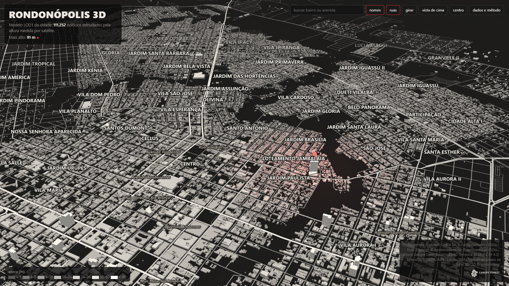

<p align="center">
  <a href="https://bonnexd01.github.io/rondonopolis-3d/"></a>
</p>

<p align="center">
  <a href="https://bonnexd01.github.io/rondonopolis-3d/"><b>Abrir o modelo 3D</b></a> ·
  <a href="#baixar-os-dados"><b>Baixar os dados</b></a> ·
  <a href="#método"><b>Método</b></a>
</p>

# Rondonópolis 3D

Modelo 3D da cidade de Rondonópolis (MT) com **112.612 edifícios** em 87,5 km² de mancha urbana. Cada prédio é extrudado pela altura medida por satélite. As ruas e os nomes dos bairros e das avenidas ajudam a se localizar.

No visualizador:

| Ação | Como |
|---|---|
| girar | arrastar |
| mover | botão direito ou Shift + arrastar |
| zoom | roda do mouse ou pinça |
| ir até um bairro ou avenida | caixa **buscar bairro ou avenida** |
| ligar e desligar nomes e ruas | botões **nomes** e **ruas** |
| ver o prédio mais alto (91 m, marcado em vermelho) | botão **centro** |

## Método

Este é o fluxo do tutorial [LIS Pro 3D: 3D City Modelling](https://www.lispro3d.com/tutorials/3d-city-modelling/01_download-prepare-data.html), adaptado para uma cidade brasileira sem LiDAR aberto. O tutorial reconstrói telhados **LOD2** de Zurique a partir de uma nuvem de pontos a laser. Aqui o modelo é **LOD1** (um bloco de telhado plano por edifício), com a altura estimada por satélite.

| Tutorial (Zurique) | Rondonópolis | Script |
|---|---|---|
| LiDAR `.laz`, MDT e footprints oficiais | Footprints do Microsoft Global ML Building Footprints (2026), MDT do TOPODATA/INPE (30 m) e limite municipal do IBGE | `01_baixar_dados.py` |
| EPSG:2056, filtro de edifícios, `proc_id` | EPSG:31981 (SIRGAS 2000 / UTM 21S), área ≥ 12 m², `proc_id` | `02_preparar.py` |
| AOI, unidades de 250 m, atribuição pelo centróide | Mancha urbana (prédios fundidos num raio de 150 m, partes ≥ 0,4 km²), unidades de 250 m, atribuição pelo centróide | `02_preparar.py` |
| Planos de telhado por RANSAC na nuvem de pontos | Altura do Google Open Buildings 2.5D Temporal 2023: percentil 75 dentro do footprint, mínimo de 2,5 m | `03_altura_google.py`, `04_processar.py` |
| Processamento paralelo por unidade e estatísticas com o MDT | Igual (`multiprocessing`); base = menor cota do MDT nos vértices | `04_processar.py` |
| Exportação CityJSON 2.0, Building/Solid, surfaceClass 0/1/2 | Igual: GroundSurface, WallSurface e RoofSurface, por unidade e da cidade inteira | `04_processar.py` |
| — | Validação da altura com os edifícios do OSM que têm número de pavimentos | `05_validar_osm.py` |
| Point Cloud Editor | Visualizador Three.js com ruas e nomes do OSM | `06_visualizar.py` |

**Validação.** Em 163 edifícios do OSM com o número de pavimentos informado, o erro absoluto mediano da altura foi de 1,05 m e o RMSE de 1,9 m. Quase todos esses prédios são de um único conjunto de 4 pavimentos, então a amostra é pequena. Uma etiqueta do OSM com 55 pavimentos (200 m) foi descartada por ser implausível. Os prédios mais altos (79 a 91 m) foram conferidos na imagem de satélite pela sombra.

**Limites.**
- A altura é estimada por um modelo de IA sobre imagem de 2023, não medida em campo. Casas térreas saem com cerca de 5 m, porque a cumeeira entra na conta.
- O terreno vem do SRTM refinado (30 m), então a base de cada prédio pode errar alguns metros.
- Em torres altas, o contorno do prédio pode cair no pódio vizinho, porque a imagem de satélite mostra o prédio alto inclinado.
- O visualizador não mostra 1.360 edifícios de núcleos afastados (a mais de 16 km do centro). Eles estão nos arquivos para baixar.

## Baixar os dados

| Arquivo | Conteúdo |
|---|---|
| [`rondonopolis_lod1.city.json.zip`](downloads/rondonopolis_lod1.city.json.zip) | CityJSON 2.0 da cidade inteira, LOD1, EPSG:31981. Abre no [ninja.cityjson.org](https://ninja.cityjson.org), no QGIS (plugin CityJSON Loader) e no Blender (Up3date) |
| [`edificios_lod1.gpkg.zip`](downloads/edificios_lod1.gpkg.zip) | Footprints com `measuredHeight`, `groundZ`, `roofHgtMax`, `pavimentosEst` e `fonteAltura`. No QGIS, use o renderizador 2.5D ou o Qgis2threejs |
| [`estatisticas_edificios.csv.zip`](downloads/estatisticas_edificios.csv.zip) | Tabela por edifício |
| [`resumo_modelo.json`](downloads/resumo_modelo.json), [`validacao_osm.json`](downloads/validacao_osm.json) | Números do modelo e da validação |

## Reproduzir

Requer Python 3.12 com `geopandas`, `rasterio`, `shapely` 2.1, `pyproj`, `requests` e `truststore`.

```
python scripts/01_baixar_dados.py rondonopolis/01_brutos
python scripts/02_preparar.py rondonopolis
python scripts/03_altura_google.py rondonopolis 2023
python scripts/04_processar.py rondonopolis 2023
python scripts/05_validar_osm.py rondonopolis
python scripts/06_visualizar.py rondonopolis
```

O `06_visualizar.py` copia o `three.min.js` (r128) de uma pasta local. Se ela não existir, use o arquivo que está em `lib/`. Para outra cidade, troque o código IBGE, a caixa de coordenadas, a folha do TOPODATA e o EPSG.

## Fontes e licenças

- **Footprints:** [Microsoft Global ML Building Footprints](https://github.com/microsoft/GlobalMLBuildingFootprints), licença ODbL. Por isso o modelo derivado (CityJSON, GeoPackage, CSV) também é distribuído sob a **ODbL**.
- **Altura:** [Google Open Buildings 2.5D Temporal](https://sites.research.google/gr/open-buildings/temporal/) (Sirko et al., 2023), licença CC BY 4.0.
- **Ruas e bairros:** © colaboradores do [OpenStreetMap](https://www.openstreetmap.org/copyright), licença ODbL.
- **Relevo:** TOPODATA, do INPE.
- **Limite municipal:** API de malhas do IBGE.
- **Método:** adaptado do tutorial LIS Pro 3D "3D City Modelling" (LASERDATA).
- **Visualizador:** [three.js](https://threejs.org) r128, licença MIT.

---

Feito por **Canopy Forest · Cerrado**.
